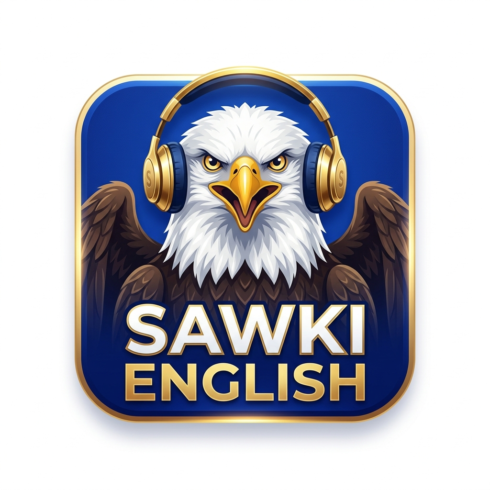

# 🎓 Sawki English

<p align="center">
  
</p>

<p align="center">
  <strong>L'application d'apprentissage d'anglais américain accéléré avec Tuteur IA et reconnaissance vocale.</strong><br>
  <em>Éditée par <strong>Sawki Technologie 2IM</strong> (Ibrahim Moudy Ibrahima)</em>
</p>

<p align="center">
  
  
  
  
  
</p>

---

## 🌟 Présentation

**Sawki English** est une application mobile d'anglais américain conçue pour les apprenants francophones. Elle allie la rigueur du Cadre Européen Commun de Référence pour les Langues (**CECRL**) avec la puissance de l'Intelligence Artificielle générative (**Google Gemini**) et de la reconnaissance vocale avancée.

### 🚀 Fonctionnalités Clés
- **Cursus 120 Leçons (A0 à C1) :** 6 paliers d'apprentissage progressif avec 20 leçons structurées par niveau (vocabulaire, grammaire, dictées et mise en situation).
- **Tuteur Vocal IA Sarah (Gemini 3.6 Flash) :** Conversation bilingue en temps réel avec correction bienveillante, explications pédagogiques en français et moteur de secours hors-ligne.
- **Atelier de Prononciation & Dictée :** Évaluation fine au microphone (Speech-to-Text) avec feedback phonétique instantané.
- **Grand Examen Final :** 30 questions de haut niveau et une attestation de réussite Sawki English partageable.
- **Mode Sombre & Clair :** Interface soignée avec boutons 3D tactiles et contraste optimisé pour un confort de lecture optimal.
- **Synchronisation Cloud & Clé Sawki :** Sauvegarde Supabase après vérification de l'email par code, et clé de restauration portative.

---

## 🛠️ Stack Technique

| Composant | Technologie |
| :--- | :--- |
| **Framework** | [Flutter](https://flutter.dev) (SDK ^3.11.5) |
| **Langage** | [Dart](https://dart.dev) |
| **State Management** | Provider |
| **Persistance Locale** | Hive |
| **Cloud Sync** | Supabase (Auth par code email, règles RLS, Edge Functions) |
| **Intelligence Artificielle** | Google Gemini 3.6 Flash API |
| **Synthèse Vocale (TTS)** | Google Cloud Text-to-Speech & Flutter TTS |
| **Reconnaissance Vocale** | Speech-to-Text Android natif |
| **Monétisation** | Google AdMob (Bannières & Vidéos Récompensées) |

---

## 🔒 Confidentialité & RGPD

Sawki English respecte la vie privée de ses utilisateurs :
- **Aucun enregistrement vocal stocké :** Le flux microphone est analysé en mémoire vive en temps réel et n'est jamais sauvegardé.
- **Politique de confidentialité officielle :** [Consulter la Politique de Confidentialité](https://raoulib.github.io/sawki-english/)

---

## 🚀 Compilation & Lancement

### Lancer en mode développement
```bash
flutter run
```
L'URL Supabase et la clé publique ont des valeurs par défaut dans `lib/core/config/app_config.dart` (elles peuvent être remplacées avec `--dart-define=SUPABASE_URL=...` et `--dart-define=SUPABASE_ANON_KEY=...`).

**Aucune clé Gemini dans l'application** : elle est stockée comme secret de la fonction Supabase `gemini`. Voir [supabase/README.md](supabase/README.md) pour le déploiement du serveur.

### Compiler le bundle pour le Google Play Store :
```bash
flutter build appbundle --release
```
La compilation release exige `android/key.properties` (voir `android/key.properties.template`).

---

## 🏢 Éditeur

**Sawki Technologie 2IM**  
Fondateur : Ibrahim Moudy Ibrahima  
Contact : `contact@sawkigroup.com`  
Copyright © 2026 Sawki Technologie 2IM. Tous droits réservés.
